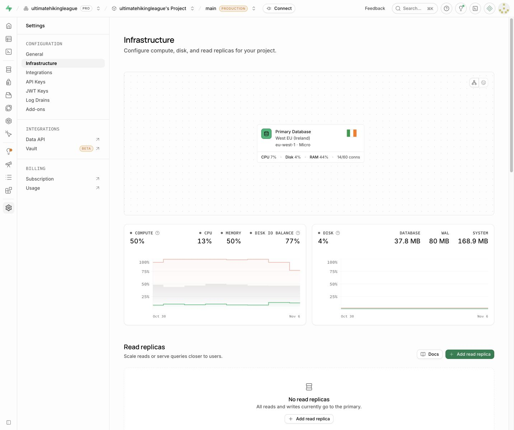

# ULTIMATE – Performance-Umsetzung vom 06.11.2026

## Ergebnis

Micro mit 1 GB RAM ist aktiv. Das automatische Rechnungsbackup arbeitet inkrementell mit wöchentlichem Server-Vollvergleich. Startseitenabfragen laufen begrenzt parallel. Unsichtbare Account-Tabs führen keine regelmäßigen Milestone-Statusabfragen mehr aus. Zwei getrennte App-Releases wurden nach Build, Tests und Prüfung der tatsächlich hochgeladenen Dateihashes kontrolliert auf die bestehenden Domains umgeschaltet.

Kalenderverkauf und seine Aktivierungsflags blieben offen/unverändert. Zahlungs-, Rechnungs-, Bestätigungs-, Gelato-Übergabe-, Punkte-, Einlösungs- und Authentifizierungscode wurde gegenüber der bisherigen Produktion nicht geändert. Keine Datenbankmigration, kein Index, keine Policy, keine Daten und keine Zugangsdaten geändert. Kein Commit oder Git-Push; vorhandene lokale Feature-Arbeiten bleiben erhalten. Der vorbereitete Gelato-Statusabgleich wurde weder veröffentlicht noch aktiviert.

Die Disk-I/O-Ursache ist noch nicht abschließend geklärt. Trotz deutlich geringerer gemessener Swap-Raten als im früheren Nano-Fenster existiert weiterhin aktive Auslagerung. Die Startseite benötigt in den kleinen Nachmessungen weiterhin etwa 2–3 Sekunden bis zu den Antwortheadern. Eine dauerhafte Behebung der Warnung wird nicht behauptet.

## 1. Compute und Kosten

- Geprüft im bestehenden Projekt astdepkrdkmufsydxviz, Organisation Pro, Region eu-west-1 (Irland).
- Ausgangszustand Nano, bis 0,5 GB; Micro 1 GB wurde ausdrücklich als Free Upgrade angeboten. Beide: 0,01344 USD/h. Alternativen u.a. Small 2 GB: 0,0206 USD/h; Medium 4 GB: 0,0822 USD/h. Keine davon gewählt.
- Upgrade-Prüfmaske: vorher 9,68 USD/Monat, nachher 9,68 USD/Monat, Differenz **+0,00 USD/Monat**, vor Steuern. Dies ist eine Compute-Schätzung, nicht die gesamte Organisationsrechnung.
- Weil ein automatischer Neustart angekündigt war, zusätzliche ausdrückliche Nutzerfreigabe eingeholt und erhalten. Wechsel ca. **19:38 Uhr MEZ**, Micro und wieder verfügbare Projektoberfläche bis ca. **19:41 Uhr MEZ** bestätigt. Die tatsächliche HTTP-Ausfallzeit wurde nicht sekündlich gemessen; keine exakt behauptete Downtime.
- Zielzustand im Dashboard: Micro ausgewählt, 1 GB. Kein neues Projekt, kein Tarifwechsel, kein Read Replica, Disk weiterhin 8 GB, Spend Cap unverändert aktiv. Nano ist nach dem Wechsel im Dashboard nicht mehr auswählbar: Ein Rückwechsel auf Nano ist deshalb kein zugesagter Rückweg.
- Abrechnung danach: Pro 25,00 USD; Compute 9,92 USD, Compute Credits −9,92 USD, Current Costs 25,00 USD. Separate Gesamtprognose Projected Costs 29,75 USD: Diese abweichende Prognose ist nicht als durch Micro verursachter Mehrpreis verifiziert. Abrechnungspositionen können laut Dashboard bis zu einer Stunde verzögert erscheinen. Der Hardwarewechsel hat nach geprüfter Tarifrate und Upgrade-Zusammenfassung keinen zusätzlichen laufenden Compute-Preis; eine abschließende Rechnung liegt noch nicht vor.
- Offizielle Abrechnung: Bezahlte Organisationen berechnen Nano zum selben Preis wie Micro; monatlich 10 USD Compute Credits, nicht kumulativ. Stundenabrechnung und unveränderte Kontingente gelten weiter. Spend Cap deckt Compute-Stunden nicht pauschal ab. Quellen: [Compute and Disk](https://supabase.com/docs/guides/platform/compute-and-disk), [Compute usage and credits](https://supabase.com/docs/guides/platform/manage-your-usage/compute).



## 2. Rechnungsbackup – historischer Stand vom 06.11.2026

Seit dem 07.11.2026 wird die Sicherung ausschließlich manuell gestartet. [Aktueller Ablauf](performance/manual-invoice-backup-20261107.md)

Der LaunchAgent `de.ultimate.shop-invoice-backup` startet unverändert `/usr/local/bin/node scripts/sync-shop-invoices.mjs` alle 300 Sekunden und bei Anmeldung. Keine neue Automation und kein zweiter Zeitplan. Erst initialer tatsächlicher Serververgleich und Tests, dann Umstellung des bestehenden Skripteinstiegs.

Der reguläre Lauf liest nur LIVE-Rechnungsnummern, prüft alle vorhandenen lokalen PDF-Header und SHA-256-Sidecars und lädt ausschließlich fehlende bzw. noch nicht vollständig gesicherte PDFs. Keine Zeitstempel-Wasserstände: Ein später erzeugtes PDF oder eine später sichtbare kleinere Nummer wird beim nächsten Metadatenscan berücksichtigt. Keyset-Pagination statt Offset-Pagination.

Bestehende PDFs werden weiterhin bytegenau durch den bisherigen atomaren Writer abgesichert und niemals ersetzt. Fehlender Sidecar erzwingt Serververgleich; abweichende Dateien oder Prüfsummen führen zum Fehler, statt sie still zu überschreiben. Temp-Dateien/Status erhalten restriktive Rechte. Ein Prozesslock verhindert parallele neue Läufe; ein nach Prozessabsturz verbliebener Lock wird bewusst nicht blind entfernt. Im Fehlerfall bleibt der letzte vollständige Erfolgsstatus erhalten; stderr und Exitcode melden den Fehler.

Der Status enthält jetzt zusätzlich Zähler, Laufzeit und `lastFullVerification`. Spätestens sieben Tage nach dem letzten erfolgreichen Vollvergleich wird automatisch wieder jedes gespeicherte Server-PDF geladen und bytegenau verglichen. Bei schlafendem/ausgeschaltetem Mac erfolgt dies beim nächsten möglichen Lauf. Ohne bisherigen Vollvergleich wird vollständig geprüft. Manueller vollständiger Prüfpfad:

```sh
cd /Users/philippdobrinski/ultimate-hiking-league
/usr/local/bin/node scripts/sync-shop-invoices.mjs --full-verify
```

Die reine lokale SHA-Prüfung erkennt keine nur serverseitige PDF-Veränderung; genau dafür bleibt der regelmäßige Server-Vollvergleich erforderlich. Ein Service-Schlüssel bleibt ausschließlich im bestehenden lokalen Zugangsdatenlader, ohne Browser-/Cache-Nutzung. Produktive Rechnungs-RLS ist aktiv und anon hat kein SELECT-Recht.

Gemessen mit der einen existierenden LIVE-Rechnung:

| Lauf | Server-PDFs | PDF-Nutzbytes (dekodiert) | Queries | Laufzeit |
|---|---:|---:|---:|---:|
| Initialer echter Vollvergleich | 1 | 59.134 | 2 | 1.632 ms |
| Direkter inkrementeller Folgelauf | 0 | 0 | 1 | 373 ms |
| Integrierter Vollvergleich, 19:37:32 MEZ | 1 | 59.134 | 2 | 717 ms |
| Automatischer Lauf, 19:40 MEZ | 0 | 0 | 1 | 524 ms |
| Automatischer Lauf, 19:45 MEZ | 0 | 0 | 1 | 1.058 ms |
| Automatischer Lauf, 19:50 MEZ | 0 | 0 | 1 | 481 ms |

Wichtig: Das bisherige Skript benötigte bei einer Rechnung ebenfalls **eine** Listenquery je regulärem Lauf. Die belegte Verbesserung ist die ausbleibende wiederholte PDF-Payload, nicht eine Halbierung der bisherigen normalen Queryzahl. Der neue vollständige Prüflauf verwendet zwei Queries. PDF-Nutzbytes sind keine gemessenen Netzwerkbytes (Base64/HTTP kommen hinzu). Keine alten Laufzeitwerte erfunden: Die bisherigen Logs enthalten keine Laufzeitmessung.

Sicherungen bleiben im bestehenden Buchhaltungsverzeichnis; keine Rechnung gelöscht, ersetzt oder neu erzeugt. Wiederherstellung einer fehlenden lokalen Datei, fehlender Sidecar, widersprüchliche lokale/Server-Dateien und nachträglich verfügbare PDFs sind automatisiert getestet. Das Originalskript vor der Umstellung liegt unter `tmp/performance-20261106/sync-shop-invoices.before.mjs`; für einen Code-Rollback dieses Skript an den bisherigen Einstieg zurückkopieren, keine PDFs oder Sidecars entfernen. Verwaisten Lock nur nach tatsächlicher Prüfung des gespeicherten Prozesses entfernen.

## 3. Liga-Startseite und Cache-Sicherheit

Unabhängige Abfragen werden paarweise parallel ausgeführt: Challenge/Site-Stats, globale/Platinum-Rangliste, Gold/Silver, Events/Partnerbuchungen und nach den Records die Hiker-/Event-Auflösung. Maximal zwei Abfragen gleichzeitig pro Seitenaufruf, statt einer unbeschränkten Query-Salve.

Keine Query entfernt oder inhaltlich verändert: SELECT-Felder, aktive Profilfilter, Divisionen, Sortierung, globale Top 10, Saisonumschaltung und Records-Limit unverändert. Die drei vollständigen Divisionslisten bleiben für das ab 2027 lokal berechnete Saisonranking erhalten. Eine Beschränkung nach Lebenszeitkilometern könnte hier fachlich falsche Top 10 ergeben. Ebenso wurde kein neuer Statusfilter eingeführt, der angezeigte Leistungen verändern würde. Fallback-Typen statt bestehender any-Typen angepasst, ohne Laufzeitänderung. Kein HTML/CSS-/Designwechsel.

Tests vergleichen Queryverträge und gerenderte Daten zwischen serieller und paralleler Ausführung, zusätzlich bei der Umsetzung gegen eine tatsächlich identische Kopie des vorigen Produktionsquelltexts: 2026/2027 und leere/gefüllte Ergebnisse. Im echten Browser waren Liga-Stand, vier Top-10-Listen, neueste Aktivitäten und nächste Events vor Domainumschaltung **inhaltlich identisch** (normalisierter Vergleich über 2.603 Zeichen). Authentifizierungsabhängige Navigation und Challenge-Button wurden nicht in einen gemeinsamen Cache übernommen.

Kein gemeinsam genutzter Daten-Cache eingeführt. Die alten produktiven SELECT-Policies für hikers und records erlauben anon/authenticated jeweils true, während aktive Profile im Anwendungscode gefiltert werden. Das ist kein Beweis, dass sämtliche Rohspalten oder jeder andere Aufruf für einen gemeinsamen Cache geeignet sind. Profilprivatisierung, tatsächliche Veröffentlichungsregeln und Cache-Invalidierung müssen vor einer weitergehenden Cache-Änderung gesondert geklärt werden. Die Parallelisierung erweitert weder Rechte noch den Abfrageumfang.

## 4. Hintergrundprozesse

- Milestone: weiterhin 30-Sekunden-Rhythmus in sichtbaren Account-Tabs. Hidden-Tabs senden keine periodischen Status-RPCs; bei visibilitychange/focus sofortige Aktualisierung. Eine laufende Anfrage wird nicht dupliziert. Cleanup verhindert neue Abfragen nach Unmount; verspätete Antworten schreiben keinen State mehr. Keine geteilte Session, kein geteilter Punktestand oder Einlösungscache.
- Nachgewiesenes Testverhalten: initial hidden null Requests; visible/focus/Timer während laufender Anfrage zusammen nur ein Request; Rückkehr aktualisiert; Cleanup entfernt Timer und Listener. Erwartete Ersparnis: bis zu 120 periodische Requests pro Stunde je bislang offenem, unsichtbarem Account-Tab; noch keine produktive Langzeit-Callrate gemessen.
- Shop-Job: minütliche Benachrichtigungs-/Fulfillment-Queue beibehalten. Keine gefährliche Intervallvergrößerung während Kalenderverkauf. Bestehende Claims, Idempotenz, Timeouts und Wiederholungen unverändert.
- Gelato-Statusabgleich: Produktionsflag nicht gesetzt, alter Produktions-Cron enthält ausschließlich `/api/shop/jobs`. Noch unveröffentlichte lokale Status-/Admin-Änderungen wurden über die isolierte Produktionskopie ausgeschlossen. Keine Aktivierung.
- Zahlungsstatus-Polling: bestehende 3-Sekunden-Abfragen mit maximal 20 Versuchen unangetastet. Kein Nachweis einer Endlosschleife.
- Admin-Kennzahlen: spätere Aggregation sinnvoll, aktuell aber kein belegter Hauptverursacher. Keine zusätzliche Datenbank-RPC eingeführt.

## 5. Tatsächliche Deployments und Rückwege

| Schritt | Deployment | Produktionsumschaltung (ca. MEZ) | Gegenüber vorher geänderte Laufzeitdateien |
|---|---|---|---|
| Baseline | dpl_9qa6nVHy1kCGfmUJkCyWoo1JNZgJ | Bestand vom 05.11. | — |
| Startseite | dpl_8gUxPfwSUPg1bg3M6jhLD5TCnN3p | 06.11., 19:52 | app/page.tsx |
| Hidden-Tab-Polling | dpl_BncuaV8UZRr1dZEVUiAmw1v4zZkb | 06.11., 19:56 | app/lib/useMilestoneLaunch.ts, app/lib/visiblePolling.ts |

Zuerst Produktionskandidaten mit `--prod --skip-domain`, erst nach erfolgreichem Build/Prüfung explizites `vercel promote`. Scope-Prüfungen anhand der über API zurückgelesenen tatsächlich hochgeladenen SHA-1-Dateihashes: [Startseite](performance/home-release-scope.json), [Polling](performance/polling-release-scope.json). Alte Produktion 146 relevante Laufzeitdateien, finale Produktion 147 wegen des neuen Polling-Helfers; keine alte Laufzeitdatei fehlt. Die vorhandenen lokalen Feature-Änderungen wurden nicht als Sammeldeployment veröffentlicht.

Finale Domainprüfung per Vercel CLI für www.ultimatehikingleague.com ergibt dpl_BncuaV8UZRr1dZEVUiAmw1v4zZkb, target production, Ready. Alle bestehenden Produktionsdomains wurden über die vorhandene Projektpromotion verwaltet, keine neue Domain hinzugefügt.

Bei Regression zunächst über den bestehenden Vercel-Rollback/Promote-Prozess auf die unmittelbar vorherige Deployment-ID zurückgehen. Ein Rollback des Polling-Releases lässt die Startseitenoptimierung erhalten; Baseline-ID nimmt beide App-Änderungen zurück. Keine Datenbank-Rollbacks erforderlich. Laufende Verkaufsvorgänge und aktuelle Umgebungsflags beim Rollback weiter beachten; keine historischen Flags überschreiben.

## 6. Messwerte und Grenzen

### Speicher, Swap und I/O

Historische Nano-Messung aus der vorhandenen Analyse: ca. 409 MiB sichtbarer Gesamtspeicher, ca. 381 MiB Swap belegt; über 3.357 s Swap-in +1.008.913 / Swap-out +924.484 Seiten, entsprechend ca. 300,5 / 275,4 Seiten/s. Kein unmittelbar vor dem Neustart neu erhobenes Vergleichsfenster gleicher Last vorhanden.

Micro-Snapshots: [1](performance/micro-snapshot-1.json), [2](performance/micro-snapshot-2.json), [3](performance/micro-snapshot-3.json), [berechnete Fenster](performance/micro-windows.json). JSON-Zeitstempel in UTC; folgende Tabelle in MEZ:

| Messung | Gesamtspeicher | Verfügbar | Swap belegt |
|---|---:|---:|---:|
| 19:41:03 | ca. 904 MiB | ca. 527 MiB | ca. 76 MiB |
| 19:45:25 | ca. 904 MiB | ca. 540 MiB | ca. 109 MiB |
| 19:56:07 | ca. 904 MiB | ca. 555 MiB | ca. 145 MiB |

| Fenster | Swap-in Seiten/s | Swap-out Seiten/s |
|---|---:|---:|
| Historisch Nano, 3.357 s | ca. 300,5 | ca. 275,4 |
| Micro, 262,669 s | 3,67 | 37,91 |
| Micro, weitere 641,588 s | 15,54 | 23,34 |

**Aktives Swapping besteht weiterhin.** Unterschiedliche Zeitfenster, Last und Neustartzustand erlauben keine saubere kausale Prozent-Ersparnis. Niedrigerer Swapstand nach Neustart allein wäre kein Erfolgskriterium. Es gibt aktuell mehr verfügbaren RAM und im gemessenen Fenster geringere Swap-Raten.

Historische nvme1n1-Raten: ca. 9,20 MB/s Lesen, 1,15 MB/s Schreiben, 372/109 Lese-/Schreiboperationen pro Sekunde. Erstes Micro-Fenster für dasselbe Gerätenamenslabel: ca. 19,5 kB/s Lesen, 68,4 kB/s Schreiben, 0,99/0,72 Ops/s. Das andere Gerät nvme0n1 las zugleich ca. 2,31 MB/s. Geräte-/Budgetzuordnung nicht unabhängig belegt, Neustart kann Zähler und Geräte ändern; dies ist keine garantierte Abrechnungsbudget-Ersparnis. Die Diagrammanzeige 77 % I/O-Balance war historisch aggregiert, kein frisch isoliertes Nachher-Fenster. Aktuelles Burstbudget und 24–48h-Verlauf bleiben offen.

### SQL-Abfragen und Sicherheitsprüfung

Lesende READ ONLY-Transaktionen mit lokal 3s Timeout, danach ROLLBACK. Keine EXPLAIN ANALYZE-Ausführung, keine Änderung an Explain-Zugriffen oder Statistiken. Ausgeführte Diagnose: [SQL](performance/read-only-diagnostics.sql).

- records, Rolle anon: Limit cost 224.32..224.34 → Sort nach activity_date DESC → Seq Scan, geschätzt 3.644 Zeilen. Schätzwerte sind keine gemessenen Millisekunden und keine vollständige PostgREST-JSON-Ausführungsanalyse.
- hikers/Gold, Rolle anon: Sort cost 132.77..133.68 → Seq Scan, Filter aktive Profile und Division gold, geschätzt 364 Ergebniszeilen. Kein Index hinzugefügt: Scan allein ist bei diesem Umfang kein ausreichender Nachweis einer profitablen Indexmigration.
- RLS für hikers/records aktiv, SELECT-Policies anon/authenticated true. hiker_season_stats ist eine View mit security_invoker=true. shop_invoices RLS aktiv, anon SELECT false. Keine Policy geändert.
- Queryreport danach: Query-ID 3366970248382160310 mit 30.772 Calls, 832.965,96 ms gesamt, 27,07 ms Mittelwert. Historisch passende Records-Abfrage 30.768 Calls. Weitere Records-bezogene IDs: −206410114548812107 120.896 Calls/0,88 ms Mittel; 928435594073674309 73.539 Calls/6,08 ms sowie eine weitere Rollen-/Datenbankzeile mit 6.350 Calls/7,55 ms; −4141494266468935873 14.693 Calls/5,93 ms. Query-ID allein identifiziert nicht Rolle/Datenbank.
- Das sind kumulierte Werte; Stats-Resetzeitpunkt noch nicht vollständig verifiziert. Daraus wurde weder eine heutige Tagesrate noch eine Verringerung der SQL-Laufzeit abgeleitet. Die Startseitenparallelisierung ändert erwartungsgemäß nicht die Queryzahl pro Seitenaufruf.

### HTTP-Antwortzeiten

Sequenzielle kleine Stichprobe aus derselben lokalen Umgebung, keine Lasttests. Je drei Startseitenabrufe, jeweils nach Micro-Upgrade; Netzwerk-/Coldstart-/Cache-Effekte nicht kontrolliert. Headerzeit ist Annäherung an Client-TTFB, keine LCP-Messung und keine reine Datenbankzeit.

| Phase | Startseiten-Headerzeiten | Median |
|---|---|---:|
| Vor App-Release | 4.223 / 3.582 / 2.465 ms | 3.582 ms |
| Nach Startseiten-Release | 3.132 / 3.001 / 2.822 ms | 3.001 ms |
| Finale Kontrolle | 2.950 / 2.501 / 2.040 ms | 2.501 ms |

Erstes positives Signal, **keine statistisch gesicherte dauerhafte Beschleunigung**. Kein sinnvoller p95 aus drei Abrufen; keine erfundenen LCP-Werte. Alle Startseitenantworten 200, identische Byteanzahl 116.107. Ranking/Division/Shop/Kalenderprodukt ebenfalls 200; vollständige Messreihen: [vorher](performance/before-home-release.json), [nach Release 1](performance/after-home-release.json), [final](performance/final-public-pages.json). Die gecachten Rankings lagen vorher bei 63/188 ms (HIT), nach Release 1 bei 296/274 ms (PRERENDER), final bei 413/545 ms; für sie ist **keine Beschleunigung nachgewiesen** und wegen unterschiedlicher Cachezustände auch keine belastbare Regression abgeleitet. Store 33 → 278 → 294 ms, Kalenderprodukt 181 → 196 → 317 ms unter denselben Einschränkungen.

Vercel-Dashboard vor Veröffentlichung: 6h-Fenster 865 CDN Requests, 628 Function Invocations, angezeigte Error Rate 0 %. Finale Kurzstichprobe ebenfalls keine HTTP-Fehler; keine Aussage zu einer dauerhaften Fehlerrate oder erfolgreicher echter Zahlung. Keine echten Testkäufe, Abbuchungen, Capture-, Produktions- oder Widerrufsvorgänge ausgelöst.

## 7. Tests und Veröffentlichungskontrollen

- Gesamte vorhandene Suite: **37 Tests, 36 bestanden, 0 fehlgeschlagen, 1 übersprungen**. Übersprungen ist der bereits vorhandene isolierte PostgreSQL-Migrationstest ohne konfigurierte Testdatenbank; keine Trackingmigration produktiv nachgeholt.
- Neue Tests: Backup/Integrität/Fehler/Lock/Wochenvergleich; Sichtbarkeit/In-flight/Cleanup; fachliche Startseitenäquivalenz 2026 und 2027. Zahlungs-/Signatur-/Live-Gate-/Bestell-/Gelato-Schutztests weiter bestanden.
- TypeScript `tsc --noEmit` erfolgreich.
- ESLint für alle in diesem Auftrag geänderten/neuen Laufzeitdateien und Tests: 0 Fehler, vier bestehende img-Warnungen der Startseite. Keine pauschale Bereinigung fremder Feature-Dateien.
- Produktions-Build im Arbeitsbaum erfolgreich. Zusätzlich beide isolierten Releasekopien gebaut; beide Vercel-Builds Ready. Bestehende Middleware-Konventionswarnung bleibt.
- Sandbox-Limits für Font-Downloads und lokalen PayPal-Testport wurden mit gezielt autorisierter Ausführung überwunden. Initiale Vercel-403 kamen von der abgelaufenen Sitzung und wurden durch reguläre CLI-Erneuerung behoben.
- Ein zu breiter Abruf entschlüsselter Environment-Variablen wurde vom automatischen Review verhindert. Danach nur Metadaten ohne Gesamtentschlüsselung und einzeln die sechs benannten nicht geheimen Flags gelesen. Aktueller Stand: Checkout/Live-Approval/Fulfillment/Confirmations=true, Payment Mode=live, Status Sync nicht gesetzt. Keine Geheimnisse in diesen Bericht oder Messdateien geschrieben.

Abschließende Routenkontrolle: `/account` und `/login` jeweils HTTP 200; `/api/shop/jobs` ohne Auth-Header HTTP 401; unveröffentlichter `/api/shop/status-jobs` HTTP 404. Kein Worker ausgelöst. [Messdatei](performance/final-route-protection.json). Automatischer Backup-Lauf um 19:55 MEZ ebenfalls erfolgreich: 0 PDF-Downloads, 1 Query, 571 ms.

## 8. Nächste Schritte nach Nutzen und Risiko

1. Über 24–48h vergleichbare Fenster mit Traffic, Swap-Raten beider Richtungen, RAM, I/O-Balance und Fehlerraten bewerten. Die bereitgestellten Snapshot-/HTTP-Skripte sind manuell und lesend; kein zusätzlicher Pollingdienst wurde eingeschaltet. Eine solche Langzeitmessung ist noch nicht abgeschlossen.
2. Vercel-Ausführung erfolgt laut tatsächlich geprüftem Deployment in **iad1**, Supabase in **eu-west-1**. Transatlantische Roundtrips sind ein plausibler Anteil der verbleibenden Sekunden. Eine nur auf die Startseite begrenzte regionale Platzierung zunächst auf zulässige Regionen, regionale Preise und Auswirkung auf Ausführung prüfen, dann separat vergleichen. Kein ungeprüfter globaler Regionswechsel des Shop-Workers.
3. Hero-Datei `public/mountain-hero.jpg` ca. 1,2 MB und bestehende img-Warnungen: LCP/Netzwerk auf Mobilgeräten messen; verlustarme Bildauslieferung bei identischer Darstellung separat testen. Keine Bild-/Layoutänderung in diesem Auftrag.
4. Öffentliche gezielte Datenloader und Invalidierung bei Profil-/Statusänderungen entwerfen. Erst dann kurzzeitiges Caching oder serverseitige Saisonaggregation; Identität der Ergebnisse und unerwünschte Datenfreigaben testen. Statische Rankingrouten haben bereits ein anderes Cacheverhalten als die force-dynamic-Startseite; pauschales Caching löst das nicht kontrolliert.
5. Query-Statistik künftig mit dbid/userid/toplevel, Resetzeit und zeitlichen Deltas erfassen. Nur bei belegtem Datenbankanteil einen spezifischen Index gegen bestehende Indizes, RLS und Schreibkosten prüfen. Nicht aus einem Seq Scan allein eine Migration ableiten.
6. Shop-Leerlaufabfragen erst separat mit vollständiger Verkaufs-/Retry-Evidenz bündeln. Die Zuverlässigkeit der aktiven Kalenderabwicklung hat Vorrang vor wenigen kleinen Leerlaufqueries.

Performance bleibt vor weiteren Feature-Entwicklungen priorisiert. Die sichere erste Umsetzungsstufe ist produktiv; Langzeit-Erfolgskontrolle und weitergehende Cache-/Regions-/Aggregationsentscheidungen bleiben ausdrücklich offen.
